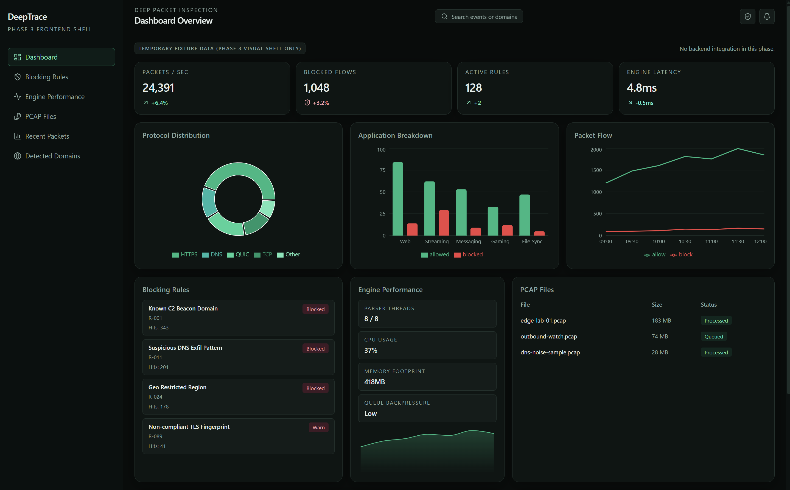
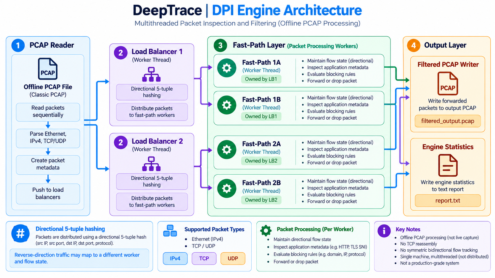
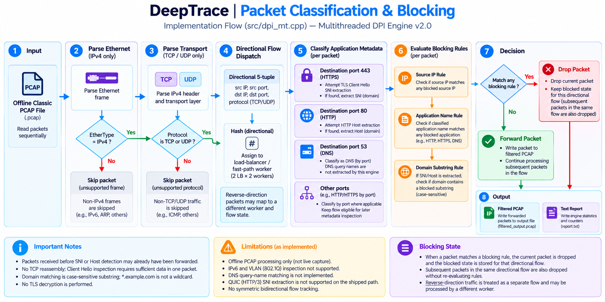

# DeepTrace

DeepTrace inspects offline PCAP files. **DPI Engine v2.0** (`src/dpi_mt.cpp`) classifies IPv4 TCP and UDP, applies blocking rules, and writes a filtered PCAP plus a text report. **FastAPI 0.1.0** launches that executable. The **React** dashboard is a fixture-only shell and does not call the API.

| Piece | Stack |
| --- | --- |
| Engine | C++17, standard library only. No third-party PCAP library. |
| API | FastAPI, Uvicorn, Pydantic, HTTPX |
| Dashboard | React 18, Vite, Tailwind. No API client. |
| Tests | pytest, pytest-asyncio |



That screenshot is the Phase 3 visual shell. It is labeled `Temporary fixture data (Phase 3 visual shell only)` and `No backend integration in this phase.` The numbers come from `frontend/src/lib/fixtures.ts`.

## Contents

1. [Overview](#overview)
2. [Repository layout](#repository-layout)
3. [Programs](#programs)
4. [Shipped engine](#shipped-engine)
5. [Test capture](#test-capture)
6. [Setup](#setup)
7. [Environment variables](#environment-variables)
8. [HTTP API](#http-api)
9. [Dashboard](#dashboard)
10. [Tests](#tests)
11. [Limitations](#limitations)
12. [Roadmap](#roadmap)

## Overview


v2.0 reads past the Ethernet, IPv4, and TCP or UDP headers. It does not decrypt TLS. It names an application from the Server Name Indication (SNI) in the Client Hello, which is still in the clear, or from an HTTP `Host` header.

A flow is one direction of the 5-tuple: source IP, destination IP, source port, destination port, and protocol (TCP is 6, UDP is 17). The reverse direction is a different tuple. v2.0 hashes and stores each direction on its own.

## Repository layout

```text
DeepTrace/
├── README.md
├── WINDOWS_SETUP.md
├── CMakeLists.txt                 # packet printer, not v2.0
├── generate_test_pcap.py
├── docs/                          # diagrams in this README
├── include/
├── src/
│   ├── dpi_mt.cpp                 # shipped v2.0
│   ├── main_working.cpp           # single-threaded DPI
│   ├── main_simple.cpp            # SNI printer
│   ├── main.cpp                   # CMake packet printer
│   ├── main_dpi.cpp               # unused v1.0 CLI
│   └── dpi_engine.cpp             # unused v1.0 core
├── backend/                       # FastAPI 0.1.0
└── frontend/                      # Vite + React shell
```

`src/` also contains `fast_path.cpp`, `load_balancer.cpp`, `rule_manager.cpp`, `connection_tracker.cpp`, `pcap_reader.cpp`, `packet_parser.cpp`, `sni_extractor.cpp`, and `types.cpp`.

Git ignores root `dpi_engine.exe` and `dpi_engine`, every `*.pcap` and `*.pcapng`, `frontend/node_modules/`, `frontend/dist/`, `.venv/`, and `__pycache__/`. API output goes to `.deeptrace-runs/` and is local working data.

## Programs

| Program | Sources | Role |
| --- | --- | --- |
| DPI Engine v2.0 | `src/dpi_mt.cpp` plus `pcap_reader.cpp`, `packet_parser.cpp`, `sni_extractor.cpp`, `types.cpp` | Shipped multi-threaded engine. The API launches this binary. |
| Single-threaded DPI | `src/main_working.cpp` and those same four files | Same classification and rules, one thread. No `--lbs` or `--fps`. |
| SNI printer | `src/main_simple.cpp` and those same four files | Prints addresses and TLS SNI. Does not write a filtered PCAP. |
| Packet printer | `src/main.cpp`, `pcap_reader.cpp`, `packet_parser.cpp` | Header printer. CMake target name: `packet_analyzer`. |
| Modular engine v1.0 | `src/main_dpi.cpp`, `src/dpi_engine.cpp`, plus the modular load-balancer, fast-path, rule, and connection-tracker sources | Separate CLI. CMake does not build it, and the API does not launch it. |

v1.0 accepts `--rules`, `--verbose`, and wildcard domains such as `*.example.com`. Those flags are not part of v2.0.

## Shipped engine

### Pipeline

The default is 2 load balancers and 2 fast paths each (4 fast paths). `--lbs` and `--fps` change the counts. Load balancer `N` owns fast-path indexes `N * fps_per_lb` through `(N + 1) * fps_per_lb - 1`. With the defaults, LB0 owns FP0 and FP1, and LB1 owns FP2 and FP3.



Each packet is hashed on its directional 5-tuple, sent to one load balancer, then hashed again onto one fast path owned by that load balancer. A SYN-ACK reverses the tuple, so it can land on a different fast path and a different flow. `FiveTuple::reverse()` is defined in `include/types.h` and is not used here. Each fast path keeps its own flow map. After the reader finishes, the process sleeps 500 ms and then stops the workers.

### Classification



On each packet the fast path looks up the directional flow, classifies it if needed, applies rules if it is not already blocked, counts the packet under its current app type, then drops it or enqueues it.

| Check | Result |
| --- | --- |
| Dest port 443 and a TLS Client Hello with SNI | `sniToAppType`. Flow is classified. |
| Dest port 80 and an HTTP `Host` header | `sniToAppType`. Flow is classified. |
| Port 53 in either direction | DNS. Flow is classified. The query name is not read. |
| Dest port 443, no SNI yet | HTTPS for this packet. Flow stays unclassified. |
| Dest port 80, no `Host` yet | HTTP for this packet. Flow stays unclassified. |

`sniToAppType` lowercases the name, then tests substrings in this order: Google, YouTube, Facebook, Instagram, WhatsApp, Twitter/X, Netflix, Amazon, Microsoft, Apple, Telegram, TikTok, Spotify, Zoom, Discord, GitHub, Cloudflare. Any other non-empty name becomes HTTPS, including the generator hosts `example.com` and `httpbin.org`.

Google is tested before YouTube and includes `ggpht`, so `yt3.ggpht.com` is Google. The later YouTube pattern `yt3.ggpht` does not run for that name. Amazon includes the substring `aws`. `SNIExtractor::extract` checks the handshake, accepts record versions SSL 3.0 through TLS 1.3, and walks the Client Hello fields with bounds checks. `QUICSNIExtractor` is never called. The TLS and QUIC app values are never assigned.

### Blocking

`Rules::isBlocked` in `src/dpi_mt.cpp` checks, in order: source IP, exact `appTypeToString` name (`YouTube`, `Twitter/X`), then a case-sensitive substring of the stored SNI. An unknown app name is reported and creates no rule. `*.example.com` is not a wildcard.

An app block sticks to later packets of that same directional flow. Packets before the SNI or `Host` header are forwarded. The reverse direction is a separate flow, so a SYN-ACK is not blocked because the forward Client Hello was blocked.

### Command line

```text
dpi_engine <input.pcap> <output.pcap> [options]
```

| Option | Meaning | Default |
| --- | --- | --- |
| `--block-ip <ipv4>` | Block that source address | none |
| `--block-app <name>` | One `appTypeToString` name | none |
| `--block-domain <text>` | Case-sensitive SNI substring | none |
| `--lbs <n>` | Load-balancer threads | 2 |
| `--fps <n>` | Fast paths per load balancer | 2 |

Fewer than three arguments prints usage and exits 1. There is no `--help` flag. The usage text starts with `DPI Engine v2.0`. On Windows the file name is `dpi_engine.exe`.

```text
dpi_engine test_dpi.pcap output.pcap --block-app YouTube --block-ip 192.168.1.50
dpi_engine test_dpi.pcap output.pcap --lbs 4 --fps 4
```

### Text report

The report goes to standard output: thread banner, rules, reader progress, counters, per-thread counts, an application breakdown, and detected SNI or `Host` values. `backend/tests/test_api.py` expects these counters for a generated `test_dpi.pcap` with no rules:

| Counter | Value |
| --- | --- |
| Total packets | 77 |
| Total bytes | 5738 |
| TCP / UDP | 73 / 4 |
| Forwarded / dropped | 77 / 0 |
| Output PCAP size | 6994 bytes |

The IP rule `192.168.1.50` expects 72 forwarded and 5 dropped. Those five packets are the generator's SYNs from that address. Thread and per-app rows are not asserted: ephemeral ports are random, so the hash split is not stable. Counts are per packet at the moment it is processed. On a YouTube handshake the SYN and ACK are still HTTPS, the Client Hello is YouTube, and the SYN-ACK is a separate Unknown flow.

## Test capture

`test_dpi.pcap` is gitignored. From the repository root:

```bash
python generate_test_pcap.py
```

| Traffic | Packets |
| --- | --- |
| 16 TLS connections: SYN, SYN-ACK, ACK, Client Hello | 64 |
| 2 HTTP connections: SYN and request (`example.com`, `httpbin.org`) | 4 |
| 4 DNS queries to `8.8.8.8` | 4 |
| 5 TCP SYNs from `192.168.1.50` | 5 |

Client Hello names: `www.google.com`, `www.youtube.com`, `www.facebook.com`, `www.instagram.com`, `twitter.com`, `www.amazon.com`, `www.netflix.com`, `github.com`, `discord.com`, `zoom.us`, `web.telegram.org`, `www.tiktok.com`, `open.spotify.com`, `www.cloudflare.com`, `www.microsoft.com`, `www.apple.com`.

Timestamps, IPv4 identification, TLS random, DNS transaction IDs, and ephemeral ports use unseeded `random` with fixed widths. The packet count and byte length stay the same. The file bytes do not. Do not force-add the capture.

## Setup

The engine needs a C++17 compiler. The API needs Python 3. The dashboard needs Node.js and npm. [`WINDOWS_SETUP.md`](WINDOWS_SETUP.md) covers Visual Studio, MinGW-w64, and WSL installers. Use the commands below to build. `CMakeLists.txt` builds `packet_analyzer` from the packet-printer sources, not v2.0.

Commands run from the repository root unless noted.

### C++ engine

Linux, macOS, or WSL. Point `DEEPTRACE_ENGINE_PATH` at `./dpi_engine`, because the API default is `dpi_engine.exe`.

```bash
g++ -std=c++17 -pthread -O2 -I include -o dpi_engine \
    src/dpi_mt.cpp src/pcap_reader.cpp src/packet_parser.cpp \
    src/sni_extractor.cpp src/types.cpp
```

Windows, Visual C++ developer prompt:

```bat
cl /EHsc /std:c++17 /O2 /I include /Fe:dpi_engine.exe ^
    src\dpi_mt.cpp src\pcap_reader.cpp src\packet_parser.cpp ^
    src\sni_extractor.cpp src\types.cpp
```

Windows, MinGW-w64:

```bat
g++ -std=c++17 -pthread -O2 -I include -o dpi_engine.exe ^
    src/dpi_mt.cpp src/pcap_reader.cpp src/packet_parser.cpp ^
    src/sni_extractor.cpp src/types.cpp
```

Other programs, same compiler flags without `-pthread`:

```bash
g++ -std=c++17 -O2 -I include -o dpi_simple src/main_working.cpp src/pcap_reader.cpp src/packet_parser.cpp src/sni_extractor.cpp src/types.cpp
g++ -std=c++17 -O2 -I include -o sni_printer src/main_simple.cpp src/pcap_reader.cpp src/packet_parser.cpp src/sni_extractor.cpp src/types.cpp
g++ -std=c++17 -O2 -I include -o packet_analyzer src/main.cpp src/pcap_reader.cpp src/packet_parser.cpp
cmake -S . -B build && cmake --build build
```

```bash
./dpi_engine test_dpi.pcap output.pcap
```

```bat
dpi_engine.exe test_dpi.pcap output.pcap
```

### Backend

```bash
python -m venv .venv
```

Windows PowerShell:

```powershell
.\.venv\Scripts\Activate.ps1
pip install -r backend/requirements.txt
cd backend
uvicorn app.main:app --reload
```

Linux or macOS:

```bash
source .venv/bin/activate
pip install -r backend/requirements.txt
cd backend
uvicorn app.main:app --reload
```

Start Uvicorn with `backend/` as the working directory so `app` imports resolve. Its default address is `http://127.0.0.1:8000`. Pins are in [`backend/requirements.txt`](backend/requirements.txt).

### Dashboard setup

```bash
cd frontend
npm install
npm run dev
npm run typecheck
npm run build
npm run preview
```

`frontend/vite.config.ts` does not set `server.port` or `server.host`. Use the URL Vite prints.

## Environment variables

Optional. Defaults are in [`backend/app/config.py`](backend/app/config.py).

| Variable | Default |
| --- | --- |
| `DEEPTRACE_PROJECT_ROOT` | Repository root (`parents[2]` of `backend/app/config.py`) |
| `DEEPTRACE_ENGINE_PATH` | `<project root>/dpi_engine.exe` |
| `DEEPTRACE_ANALYSIS_DIR` | `<project root>/.deeptrace-runs` |
| `DEEPTRACE_RULES_PATH` | `<analysis dir>/rules.json` |
| `DEEPTRACE_ENGINE_TIMEOUT` | `300` seconds, must be greater than zero |

`backend/tests/conftest.py` pins the engine to `<project root>/dpi_engine.exe` and the timeout to 30 seconds.

## HTTP API

DeepTrace API 0.1.0. Every route is under `/api`. The service reads the engine's standard output and standard error together. Enabled rules are appended in stored order as `--block-ip`, `--block-app`, or `--block-domain`.

### Health

`GET /api/health` returns `status: "ok"` when the process is up, plus an `engine` object: `available`, `path`, `version`, `detail`. `available` is false when the executable is missing or cannot start. `version` is `2.0` when the usage text contains `DPI Engine v2.0`.

### Engine status

`GET /api/engine/status` returns that same `engine` object. The check runs the binary with `--help`. v2.0 has no help flag, prints usage, and exits 1. Exit codes 0 and 1 both count as available. The version token is parsed from either stream.

### Analyses

`POST /api/analyses` with `{ "input_file": "test_dpi.pcap" }`. A relative path is resolved from the project root. It must be an existing file inside that root, not the root itself, with a `.pcap` suffix. Magic may be classic or nanosecond PCAP, either endian.

The service writes `<analysis dir>/<id>.pcap`, runs the engine, and parses the report. `packets` is a second parse of the **input** capture, so dropped frames stay in the list. Each packet has `index`, `timestamp`, `length`, `source_ip`, `destination_ip`, `protocol`, `source_port`, and `destination_port`. Ports and timestamp fractions are random in the generator, so they are not listed here.

With no rules, the API test expects the counters in [Text report](#text-report). `thread_statistics` and `applications` are empty with the current parser. See [Limitations](#limitations). `domains` can contain lines such as `- www.youtube.com -> YouTube`.

| Status | When |
| --- | --- |
| 200 | Analysis finished |
| 400 | Path outside the project, missing, not a file, not `.pcap`, or rejected magic |
| 422 | A counter is missing from the report, or the input PCAP is truncated while packets are listed |
| 502 | Engine missing, non-zero exit, or no output PCAP |
| 504 | Runtime exceeds `DEEPTRACE_ENGINE_TIMEOUT` |

### Rules

| Method | Path | Success |
| --- | --- | --- |
| `GET` | `/api/rules` | 200, JSON array |
| `POST` | `/api/rules` | 201, created rule |
| `PATCH` | `/api/rules/{rule_id}` | 200, updated rule |
| `DELETE` | `/api/rules/{rule_id}` | 204, empty body |

```json
{ "type": "ip", "value": "192.168.1.50", "enabled": true }
```

`type` is `ip`, `app`, or `domain`. `value` is required and at most 253 characters. `enabled` defaults to true. Stored rules also have `id` and `created_at`.

| Type | Accepted value |
| --- | --- |
| `ip` | Any address `ipaddress` accepts, including IPv6 |
| `app` | Google, YouTube, Facebook, Instagram, Twitter/X, Netflix, Amazon, Microsoft, Apple, WhatsApp, Telegram, TikTok, Spotify, Zoom, Discord, GitHub, Cloudflare, HTTP, HTTPS, DNS, TLS, QUIC |
| `domain` | After an optional `*.` prefix, the remainder must contain a dot and no whitespace. The stored value keeps the prefix. |

Invalid values return 422. An unknown id on update or delete returns 404.

The API accepts TLS, QUIC, and IPv6. v2.0 never assigns TLS or QUIC, and it parses only dotted IPv4, so those rules do not match. A stored `*.example.com` is passed through unchanged, and v2.0 searches for that literal substring.

## Dashboard

Routes: `/` dashboard, `/blocking-rules`, `/performance`, `/pcap-files`, `/recent-packets`, `/domains`. Any other path redirects to `/`. The other five screens are placeholders.

The preview at the top of this file is that shell. It does not load analyses, rules, or captures. KPI and chart figures are fixture data, not measurements.

## Tests

From `backend/` with the virtual environment active:

```bash
cd backend
pytest
```

`conftest.py` adds `backend/` to `sys.path` and uses a temporary rules file and analysis directory. These tests need `dpi_engine.exe` and `test_dpi.pcap` at the project root:

- `test_health_and_engine_status`
- `test_successful_analysis_against_sample_pcap`
- `test_ip_blocking_is_applied_by_engine`

Path checks, rule lifecycle, and the mocked timeout and failure tests do not need a successful engine run.

```bash
cd frontend
npm run typecheck
```

There is no frontend lint script.

## Limitations

- v2.0 accepts classic PCAP magic `0xa1b2c3d4` and swapped `0xd4c3b2a1`. The API also accepts nanosecond PCAP. The engine then fails and the API returns 502.
- Only IPv4 TCP and UDP are counted. Other packets are skipped. Payload offsets assume 14-byte Ethernet, so VLAN is not handled. IPv6 is not inspected.
- SNI is read only from a Client Hello to port 443. Encrypted Client Hello hides it. HTTP `Host` is read only on port 80. DNS is port 53 only. QUIC is not classified.
- Blocking follows one direction. The 500 ms shutdown can leave queued packets counted but neither forwarded nor dropped. The 77-packet test, with no rules, sees 77 forwarded and 0 dropped.
- `parse_report` finds the six counters inside box-drawing lines. Application and thread rows start with `║` and do not match, so those API lists are empty. Domain lines after the box can match.
- A fresh clone has no `dpi_engine.exe` and no `test_dpi.pcap` until they are built and generated. No performance numbers are published here.

## Roadmap

Not on the shipped path:

- Track both directions as one flow before blocking.
- Drain worker queues instead of sleeping 500 ms.
- Parse boxed application and thread rows, and test them.
- Use one domain-rule meaning in the API and in v2.0. The API keeps a `*.` prefix; v2.0 searches for that literal text.
- Reject TLS, QUIC, and IPv6 rules until the engine can enforce them.
- Parse QUIC Client Hellos. The unused extractor is not that parser.
- Connect the dashboard to `/api/analyses` and `/api/rules`, and replace `frontend/src/lib/fixtures.ts`.

v1.0 already has a rule-file loader and a `*.example.com` suffix match. That code is not linked into `dpi_engine.exe`.
