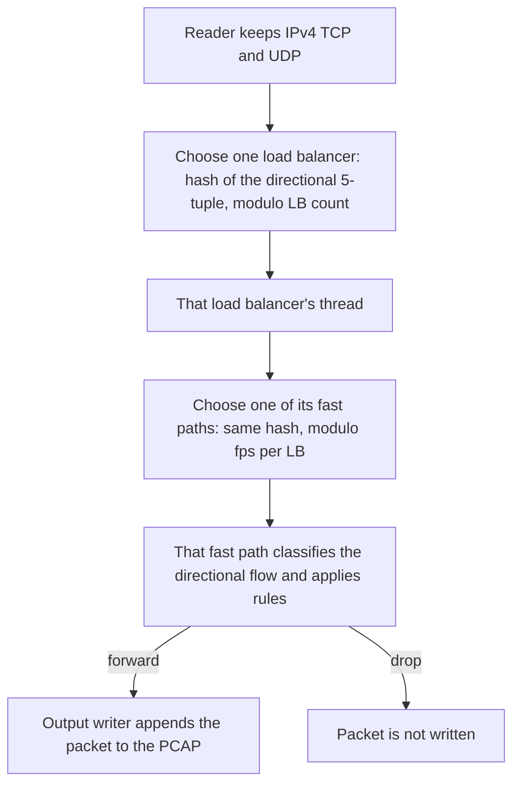

# DeepTrace

DeepTrace is an offline PCAP deep packet inspection project. A C++ engine reads a capture, classifies IPv4 TCP and UDP packets, applies blocking rules, and writes a filtered PCAP plus a text report. A FastAPI service runs that engine. A React dashboard displays a fixed visual shell and does not call the API.

The shipped engine is **DPI Engine v2.0**, built from [`src/dpi_mt.cpp`](src/dpi_mt.cpp). It inspects offline captures. It does not sit inline on a live network interface.

## Contents

1. [Overview](#overview)
2. [Repository layout](#repository-layout)
3. [Programs](#programs)
4. [Shipped engine](#shipped-engine)
   - [Pipeline](#pipeline)
   - [Classification](#classification)
   - [Blocking](#blocking)
   - [Command-line interface](#command-line-interface)
   - [Text report](#text-report)
5. [Test capture](#test-capture)
6. [Setup](#setup)
   - [C++ engine](#c-engine)
   - [Backend](#backend)
   - [Dashboard](#dashboard-setup)
7. [Environment variables](#environment-variables)
8. [HTTP API](#http-api)
   - [Health](#health)
   - [Engine status](#engine-status)
   - [Analyses](#analyses)
   - [Rules](#rules)
9. [Dashboard](#dashboard)
10. [Tests](#tests)
11. [Limitations](#limitations)
12. [Roadmap](#roadmap)

## Overview


Deep packet inspection here means reading past the Ethernet, IPv4, and TCP or UDP headers into the start of the payload.

HTTPS encrypts the application data after the handshake. The TLS Client Hello still carries the Server Name Indication (SNI) in the clear, and that name is what v2.0 uses to name an application. The engine does not decrypt TLS.

A flow is the directional 5-tuple:

| Field | Role |
| --- | --- |
| Source IP | Sending host |
| Destination IP | Receiving host |
| Source port | Sending port |
| Destination port | Receiving port |
| Protocol | TCP (6) or UDP (17) |

The reverse direction is a different 5-tuple. v2.0 hashes and stores each direction on its own.

## Repository layout

```text
DeepTrace/
├── README.md
├── WINDOWS_SETUP.md          # Extra Windows installer notes
├── CMakeLists.txt            # Builds the packet printer, not v2.0
├── generate_test_pcap.py     # Writes a local test_dpi.pcap
├── include/                  # Shared headers
├── src/
│   ├── dpi_mt.cpp            # Shipped v2.0 engine
│   ├── main_working.cpp      # Single-threaded DPI tool
│   ├── main_simple.cpp       # Single-file SNI printer
│   ├── main.cpp              # CMake packet printer
│   ├── main_dpi.cpp          # Unused v1.0 command line
│   ├── dpi_engine.cpp        # Unused v1.0 core
│   ├── fast_path.cpp
│   ├── load_balancer.cpp
│   ├── rule_manager.cpp
│   ├── connection_tracker.cpp
│   ├── pcap_reader.cpp
│   ├── packet_parser.cpp
│   ├── sni_extractor.cpp
│   └── types.cpp
├── backend/
│   ├── requirements.txt
│   ├── pytest.ini
│   ├── app/                  # FastAPI 0.1.0
│   └── tests/
└── frontend/                 # Vite + React visual shell
```

These paths are created or built locally and are not part of the Git tree:

| Path | Why it is absent |
| --- | --- |
| `dpi_engine.exe`, `dpi_engine` | Root engine binaries are gitignored |
| `test_dpi.pcap` and other `*.pcap` / `*.pcapng` files | Captures are gitignored |
| `frontend/node_modules/`, `frontend/dist/` | Dependencies and build output |
| `.venv/`, `__pycache__/` | Local Python environment |
| `.deeptrace-runs/` | Default directory for API analysis output |

## Programs

| Program | Sources | What it is |
| --- | --- | --- |
| Shipped engine, DPI Engine v2.0 | `src/dpi_mt.cpp` plus `pcap_reader.cpp`, `packet_parser.cpp`, `sni_extractor.cpp`, `types.cpp` | Multi-threaded offline DPI tool. The API launches this executable. |
| Single-threaded DPI tool | `src/main_working.cpp` and the same four support files | Same classification and rule ideas on one thread, with no `--lbs` or `--fps`. |
| SNI printer | `src/main_simple.cpp` and the same four support files | Reads one PCAP and prints addresses and any TLS SNI. It does not filter or write an output capture. |
| Packet printer | `src/main.cpp`, `pcap_reader.cpp`, `packet_parser.cpp` | Prints parsed headers. `CMakeLists.txt` builds this target as `packet_analyzer`. |
| Modular engine v1.0 | `src/main_dpi.cpp`, `src/dpi_engine.cpp`, and the modular load-balancer, fast-path, rule, and connection-tracker sources | Separate CLI labeled v1.0. It is not compiled by CMake and the API does not launch it. |

v1.0 accepts `--rules`, `--verbose`, and wildcard domain patterns such as `*.example.com`. Those options belong to that unused program. The shipped v2.0 command line is documented below.

## Shipped engine

### Pipeline

Default threading is 2 load balancers and 2 fast paths per load balancer (4 fast paths). `--lbs` and `--fps` change those counts. Load balancer `N` owns fast-path indexes `N * fps_per_lb` through `(N + 1) * fps_per_lb - 1`.




With the defaults, LB0 owns FP0 and FP1, and LB1 owns FP2 and FP3. Each packet is delivered to one load balancer and then to one fast path in that load balancer's group. A reversed packet, such as a SYN-ACK, has the opposite 5-tuple, so its hash can select a different load balancer and fast path. `FiveTuple::reverse()` exists in `include/types.h` and is not used by this pipeline.

Each fast path has its own flow map. After the reader finishes, the process sleeps 500 ms and then stops the workers.

### Classification


Processing order inside one fast path:

1. Look up the directional 5-tuple.
2. If that flow is not yet classified, try the checks below.
3. If the flow is not already blocked, apply rules to its source IP, app type, and SNI.
4. Count the packet under the app type it has at that moment.
5. Drop it, or push it to the output queue.

Classification checks, in order:

| Check | Result |
| --- | --- |
| Destination port 443 and a TLS Client Hello with SNI | App comes from `sniToAppType`. The flow is classified. |
| Destination port 80 and an HTTP `Host` header | App comes from `sniToAppType`. The flow is classified. |
| Port 53 in either direction | App is DNS. The flow is classified. The DNS name is not read. |
| Destination port 443 with no SNI yet | App is HTTPS for this packet. The flow stays unclassified so a later Client Hello can replace it. |
| Destination port 80 with no `Host` yet | App is HTTP for this packet. The flow stays unclassified. |

`sniToAppType` lowercases the name and tests substrings in this order: Google, YouTube, Facebook, Instagram, WhatsApp, Twitter/X, Netflix, Amazon, Microsoft, Apple, Telegram, TikTok, Spotify, Zoom, Discord, GitHub, Cloudflare. A non-empty name that matches none of those patterns becomes HTTPS. The generator hosts `example.com` and `httpbin.org` take that path.

Google is tested before YouTube and includes `ggpht`. A name such as `yt3.ggpht.com` is Google. The later YouTube pattern `yt3.ggpht` does not run for that name. Amazon includes the substring `aws`.

`QUICSNIExtractor` is implemented in `src/sni_extractor.cpp` and is never called by v2.0. The enum values TLS and QUIC are never assigned on this path.

The SNI walk in `SNIExtractor::extract` checks the handshake type, accepts record versions from SSL 3.0 through TLS 1.3, and advances through the session ID, cipher suites, compression methods, and extensions with bounds checks. This layout is the field order that walk follows. It is not a copy of the parser:

```text
Content type 0x16, record version, record length
Handshake type 0x01, 24-bit length
Client version, 32-byte random, session ID, cipher suites, compression
Extensions, including type 0x0000 hostname SNI
```

### Blocking

`Rules::isBlocked` checks the source IP, then the app type, then whether the stored SNI contains a blocked domain as a case-sensitive substring. Domain matching does not lowercase the SNI and does not treat `*.example.com` as a wildcard.

An app name must match `appTypeToString` exactly, including `YouTube` and `Twitter/X`. An unknown name is reported and does not create a rule.

An app block becomes sticky for later packets of that same directional flow. Packets seen before the SNI or `Host` header are forwarded. The reverse direction is a separate flow, so a SYN-ACK is not blocked merely because the forward Client Hello was blocked.

The behavior below is a summary of `Rules::isBlocked` in `src/dpi_mt.cpp`, not a standalone program:

```text
if source IP is blocked: drop
else if app type is blocked: drop
else if any blocked domain is a substring of the SNI: drop
else: forward
```

### Command-line interface

```text
dpi_engine <input.pcap> <output.pcap> [options]
```

| Option | Meaning | Default |
| --- | --- | --- |
| `--block-ip <ipv4>` | Block that source address | none |
| `--block-app <name>` | Block one `appTypeToString` name | none |
| `--block-domain <text>` | Case-sensitive SNI substring | none |
| `--lbs <n>` | Load-balancer threads | 2 |
| `--fps <n>` | Fast paths owned by each load balancer | 2 |

Fewer than three arguments prints usage and returns exit code 1. There is no separate `--help` flag. The usage text starts with `DPI Engine v2.0`.

```text
dpi_engine test_dpi.pcap output.pcap --block-app YouTube --block-ip 192.168.1.50
dpi_engine test_dpi.pcap output.pcap --lbs 4 --fps 4
```

On Windows the executable name is `dpi_engine.exe`.

### Text report

The report is written to standard output. Its sections are the thread banner, active rules, reader progress, packet counters, per-thread dispatch and processed counts, an application breakdown, and detected SNI or `Host` values.

Counters that `backend/tests/test_api.py` expects for a generated `test_dpi.pcap` with no rules:

| Counter | Value |
| --- | --- |
| Total packets | 77 |
| Total bytes | 5738 |
| TCP packets | 73 |
| UDP packets | 4 |
| Forwarded | 77 |
| Dropped | 0 |
| Output PCAP size | 6994 bytes |

With only the IP rule `192.168.1.50`, the same test expects 72 forwarded and 5 dropped. Those five packets are the SYNs the generator writes from that address. Thread rows and per-app rows are not asserted. They depend on directional hashing, and the generator chooses ephemeral ports at random, so a pasted thread breakdown would not be a stable result.

Application counts are per packet, using the app type at the time that packet is processed. A YouTube handshake therefore does not count all four of its packets as YouTube: the SYN and ACK are still HTTPS, the Client Hello is YouTube, and the SYN-ACK is a separate Unknown flow.

## Test capture

`test_dpi.pcap` is gitignored. Generate it from the repository root:

```bash
python generate_test_pcap.py
```

The script writes `test_dpi.pcap` in the current directory. Its contents are:

| Traffic | Packets |
| --- | --- |
| 16 TLS connections on port 443, each SYN, SYN-ACK, ACK, and Client Hello | 64 |
| 2 HTTP connections on port 80, each SYN and request | 4 |
| 4 DNS queries to `8.8.8.8` | 4 |
| 5 TCP SYNs from `192.168.1.50` | 5 |

The Client Hello names are `www.google.com`, `www.youtube.com`, `www.facebook.com`, `www.instagram.com`, `twitter.com`, `www.amazon.com`, `www.netflix.com`, `github.com`, `discord.com`, `zoom.us`, `web.telegram.org`, `www.tiktok.com`, `open.spotify.com`, `www.cloudflare.com`, `www.microsoft.com`, and `www.apple.com`. The HTTP hosts are `example.com` and `httpbin.org`.

Timestamps, IPv4 identification, TLS random bytes, DNS transaction IDs, and ephemeral ports use unseeded `random`. Those fields have fixed widths, so the packet count and byte length stay the same while the file bytes change from run to run. Do not force-add the capture to Git.

## Setup

Requirements for the engine are a C++17 compiler. The engine sources do not link a third-party PCAP library. The API needs Python 3. The dashboard needs Node.js and npm.

[`WINDOWS_SETUP.md`](WINDOWS_SETUP.md) has installer steps for Visual Studio, MinGW-w64, and WSL. Use the commands in this README to build and run. `CMakeLists.txt` produces `packet_analyzer` from the packet printer sources. Building that CMake target does not produce the v2.0 engine.

### C++ engine

From the repository root.

Linux, macOS, or WSL:

```bash
g++ -std=c++17 -pthread -O2 -I include -o dpi_engine \
    src/dpi_mt.cpp \
    src/pcap_reader.cpp \
    src/packet_parser.cpp \
    src/sni_extractor.cpp \
    src/types.cpp
```

The API looks for `dpi_engine.exe` unless `DEEPTRACE_ENGINE_PATH` points at `./dpi_engine`.

Windows, Visual C++ developer prompt:

```bat
cl /EHsc /std:c++17 /O2 /I include /Fe:dpi_engine.exe ^
    src\dpi_mt.cpp ^
    src\pcap_reader.cpp ^
    src\packet_parser.cpp ^
    src\sni_extractor.cpp ^
    src\types.cpp
```

Windows, MinGW-w64:

```bat
g++ -std=c++17 -pthread -O2 -I include -o dpi_engine.exe ^
    src/dpi_mt.cpp ^
    src/pcap_reader.cpp ^
    src/packet_parser.cpp ^
    src/sni_extractor.cpp ^
    src/types.cpp
```

Single-threaded DPI tool:

```bash
g++ -std=c++17 -O2 -I include -o dpi_simple \
    src/main_working.cpp \
    src/pcap_reader.cpp \
    src/packet_parser.cpp \
    src/sni_extractor.cpp \
    src/types.cpp
```

SNI printer:

```bash
g++ -std=c++17 -O2 -I include -o sni_printer \
    src/main_simple.cpp \
    src/pcap_reader.cpp \
    src/packet_parser.cpp \
    src/sni_extractor.cpp \
    src/types.cpp
```

Packet printer, which is also the CMake target:

```bash
g++ -std=c++17 -O2 -I include -o packet_analyzer \
    src/main.cpp \
    src/pcap_reader.cpp \
    src/packet_parser.cpp
```

```bash
cmake -S . -B build
cmake --build build
```

Run v2.0 after generating the capture:

```bash
./dpi_engine test_dpi.pcap output.pcap
```

```bat
dpi_engine.exe test_dpi.pcap output.pcap
```

### Backend

From the repository root:

```bash
python -m venv .venv
```

Windows PowerShell:

```powershell
.\.venv\Scripts\Activate.ps1
pip install -r backend/requirements.txt
cd backend
uvicorn app.main:app --reload
```

Linux or macOS:

```bash
source .venv/bin/activate
pip install -r backend/requirements.txt
cd backend
uvicorn app.main:app --reload
```

Uvicorn's default listen address is `http://127.0.0.1:8000`. The app factory is `app.main:app`, and the process must be started with `backend/` as the working directory so `app` imports resolve. Dependencies are FastAPI, Uvicorn, Pydantic, HTTPX, pytest, and pytest-asyncio, pinned in [`backend/requirements.txt`](backend/requirements.txt).

### Dashboard setup

```bash
cd frontend
npm install
npm run dev
npm run typecheck
npm run build
npm run preview
```

`frontend/vite.config.ts` does not set `server.port` or `server.host`. The URL is the one Vite prints when `npm run dev` starts.

## Environment variables

All of these are optional. Defaults come from [`backend/app/config.py`](backend/app/config.py).

| Variable | Default |
| --- | --- |
| `DEEPTRACE_PROJECT_ROOT` | Repository root, two parents above `backend/app/config.py` |
| `DEEPTRACE_ENGINE_PATH` | `<project root>/dpi_engine.exe` |
| `DEEPTRACE_ANALYSIS_DIR` | `<project root>/.deeptrace-runs` |
| `DEEPTRACE_RULES_PATH` | `<analysis dir>/rules.json` |
| `DEEPTRACE_ENGINE_TIMEOUT` | `300` seconds. The value must be greater than zero. |

On Linux or macOS, set `DEEPTRACE_ENGINE_PATH` to the `dpi_engine` binary produced by `g++`. The tests in `backend/tests/conftest.py` pin the engine path to `<project root>/dpi_engine.exe` and the timeout to 30 seconds.

## HTTP API

The service title is DeepTrace API, version 0.1.0. Routes are mounted under `/api`.

### Health

`GET /api/health`

```json
{
  "status": "ok",
  "engine": {
    "available": true,
    "path": "<project root>/dpi_engine.exe",
    "version": "2.0",
    "detail": "Engine executable is available"
  }
}
```

`status` is `ok` when the API process is up. `engine.available` is a separate field and is false when the executable is missing or cannot start.

### Engine status

`GET /api/engine/status`

Returns the same `engine` object. Availability is true when the executable exists and running it with `--help` exits 0 or 1. v2.0 treats that extra argument as usage and exits 1, which this check accepts. The version is parsed from `DPI Engine v` followed by a version token in either output stream.

### Analyses

`POST /api/analyses`

```json
{ "input_file": "test_dpi.pcap" }
```

The path may be relative to the project root. It must resolve to an existing file inside that root, must not be the root directory itself, and must use a `.pcap` suffix. The magic number must be classic PCAP or nanosecond PCAP, in either endianness.

The service writes `<analysis dir>/<id>.pcap`, passes every enabled rule to the engine, and parses the report. `packets` is a second parse of the input capture, so frames the engine dropped are still listed.

```json
{
  "id": "hex",
  "input_file": "absolute input path",
  "output_file": "absolute output path",
  "created_at": "UTC timestamp",
  "report": {
    "total_packets": 77,
    "total_bytes": 5738,
    "tcp_packets": 73,
    "udp_packets": 4,
    "forwarded_packets": 77,
    "dropped_packets": 0,
    "thread_statistics": [],
    "applications": [],
    "domains": []
  },
  "packets": []
}
```

The numeric report fields above are the no-rule expectations from the API test. `thread_statistics` and `applications` are empty with the current parser even when the text report contains those sections. See [Limitations](#limitations). `domains` can contain entries parsed from lines such as `- www.youtube.com -> YouTube`. Each packet record has `index`, `timestamp`, `length`, `source_ip`, `destination_ip`, `protocol`, `source_port`, and `destination_port`. Ephemeral ports and timestamp fractions come from the generator's unseeded random values, so they are not listed here.

| Status | When |
| --- | --- |
| 200 | Analysis finished |
| 400 | Path is outside the project, missing, not a file, not `.pcap`, or has a rejected magic number |
| 422 | The engine report is missing one of the six counters, or the input PCAP is truncated while packets are listed |
| 502 | The engine is missing, exits non-zero, or does not create the output PCAP |
| 504 | The run exceeds `DEEPTRACE_ENGINE_TIMEOUT` |

Enabled rules are appended in stored order:

| Rule type | Engine argument |
| --- | --- |
| `ip` | `--block-ip <value>` |
| `app` | `--block-app <value>` |
| `domain` | `--block-domain <value>` |

The API reads standard output and standard error together, so the report is found on either stream.

### Rules

| Method | Path | Success |
| --- | --- | --- |
| `GET` | `/api/rules` | 200 and a JSON array |
| `POST` | `/api/rules` | 201 and the created rule |
| `PATCH` | `/api/rules/{rule_id}` | 200 and the updated rule |
| `DELETE` | `/api/rules/{rule_id}` | 204 with no body |

Request body for create and update:

```json
{ "type": "ip", "value": "192.168.1.50", "enabled": true }
```

`type` is `ip`, `app`, or `domain`. `value` is required, at most 253 characters. `enabled` defaults to true. A stored rule also has `id` and `created_at`.

Validation:

| Type | Accepted value |
| --- | --- |
| `ip` | An address accepted by Python's `ipaddress`, including IPv6 |
| `app` | One of Google, YouTube, Facebook, Instagram, Twitter/X, Netflix, Amazon, Microsoft, Apple, WhatsApp, Telegram, TikTok, Spotify, Zoom, Discord, GitHub, Cloudflare, HTTP, HTTPS, DNS, TLS, QUIC |
| `domain` | After an optional `*.` prefix, the remainder must contain a dot and no whitespace. The stored value keeps the prefix. |

Invalid values return 422. An unknown rule id on update or delete returns 404.

TLS and QUIC are accepted as API app names. v2.0 never assigns those app types, so those rules do not match traffic. An IPv6 rule passes API validation. v2.0 parses dotted IPv4 into a 32-bit value, so an IPv6 rule does not match packets. A domain stored as `*.example.com` is sent to v2.0 unchanged, and v2.0 looks for that literal substring.

## Dashboard

The frontend is a React 18, Vite, and Tailwind shell. It has no API client.


| Path | Screen |
| --- | --- |
| `/` | Dashboard |
| `/blocking-rules` | Placeholder section |
| `/performance` | Placeholder section |
| `/pcap-files` | Placeholder section |
| `/recent-packets` | Placeholder section |
| `/domains` | Placeholder section |

Any other path redirects to `/`. The dashboard label is `Temporary fixture data (Phase 3 visual shell only)`, and the dashboard page states `No backend integration in this phase.` Charts and KPI figures in `frontend/src/lib/fixtures.ts` are hardcoded sample UI data. They are not measurements from the engine.

## Tests

From `backend/` with the virtual environment active and `backend/` on the import path:

```bash
cd backend
pytest
```

`backend/tests/conftest.py` inserts `backend/` onto `sys.path` and builds the app with a temporary rules file and analysis directory. These tests call the real `dpi_engine.exe` and read `test_dpi.pcap` from the project root:

- `test_health_and_engine_status`
- `test_successful_analysis_against_sample_pcap`
- `test_ip_blocking_is_applied_by_engine`

Path, timeout, failure, and rule-lifecycle tests do not need a successful engine run. The timeout and failure tests replace `run_analysis`.

Frontend typecheck:

```bash
cd frontend
npm run typecheck
```

There is no frontend lint script.

## Limitations

- v2.0 reads classic PCAP magic `0xa1b2c3d4` and the swapped magic `0xd4c3b2a1`. The API also accepts nanosecond PCAP magic. A nanosecond file can pass the API check and then fail in the engine, which returns 502.
- The engine keeps IPv4 TCP and UDP. Other packets are skipped and are not included in the packet counters. Payload offsets assume a 14-byte Ethernet header, so VLAN tags are not handled. IPv6 is not inspected.
- SNI is taken only from a Client Hello whose destination port is 443. Encrypted Client Hello hides that name. HTTP `Host` is read only when the destination port is 80. DNS is classified by port 53 only.
- QUIC on UDP/443 is not classified. The QUIC helper in `src/sni_extractor.cpp` is unused by v2.0.
- Flows and hashes are directional. Blocking does not follow the reverse tuple.
- The reader sleeps 500 ms and then stops workers that still have queued packets. Those packets can be included in the input counters and then neither forwarded nor dropped. The 77-packet API test observes no loss: 77 forwarded and 0 dropped with no rules.
- Domain rules are case-sensitive substrings. App rules that the API accepts for TLS, QUIC, and IPv6 do not match this engine's classifier or IPv4 parser.
- `parse_report` extracts the six counters from anywhere in a line, so the box-drawing characters around those counters still work. Application and thread lines in the text report start with `║`, and the parser only matches those rows at the start of a stripped line, so `applications` and `thread_statistics` come back empty. Domain lines after the report box can match.
- The dashboard does not load analyses, rules, or captures.
- Engine binaries and every PCAP are gitignored. A fresh clone has neither `dpi_engine.exe` nor `test_dpi.pcap` until they are built and generated.
- No performance numbers are published here. The fixture KPI values in the dashboard are UI placeholders.

## Roadmap

These items are not implemented on the shipped path:

- Tie both directions of a connection to one flow before applying a block.
- Drain the worker queues before shutdown, instead of sleeping for a fixed 500 ms.
- Parse application and thread rows from the boxed report, and test those fields.
- Make domain rules mean one thing in the API and in v2.0. Today the API accepts a `*.` prefix and v2.0 searches for that literal text.
- Reject or ignore API app names and address families that v2.0 cannot enforce, including TLS, QUIC, and IPv6, until the engine implements them.
- Call a real QUIC Client Hello parser. The unused extractor is not that parser.
- Connect the dashboard to `/api/analyses` and `/api/rules`, and replace `frontend/src/lib/fixtures.ts`.

v1.0 already contains a rule file loader and a `*.example.com` suffix match. That code remains unlinked from `dpi_engine.exe`.
